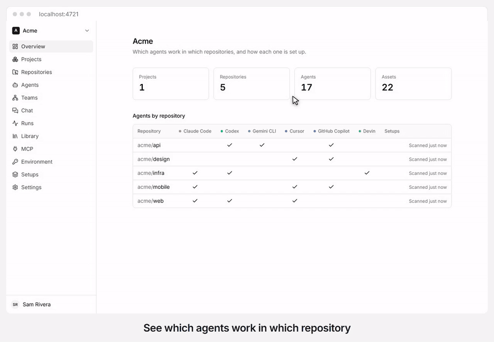

<p align="center">
  
</p>

<h1 align="center">Gateweave Agents</h1>

<p align="center">
  <strong>See which coding agents work where, keep what they read in one place, and run your own teams of agents.</strong><br>
  Open source, on Cloudflare, with no server to run.
</p>

<p align="center">
  <a href="https://github.com/gateweavehq/agents/releases/latest"></a>
  <a href="https://github.com/gateweavehq/agents/actions/workflows/ci.yml?query=branch%3Amain"></a>
  <a href="LICENSE"></a>
</p>

<p align="center">
  <a href="https://gateweave.com/agents"><strong>See what it does</strong></a> ·
  <a href="#self-hosting"><strong>Deploy your own</strong></a> ·
  <a href="setups/">Ready-made setups</a>
</p>

<picture>
  <source media="(prefers-color-scheme: dark)" srcset="docs/images/tour-dark.gif">
  
</picture>

<p align="center">
  The real build, with made-up repositories on a stand-in GitHub and a stand-in for the model, so the
  answer and its numbers are for show. The time spent loading is cut out.
</p>

<p align="center">
  <a href="https://deploy.workers.cloudflare.com/?url=https://github.com/gateweavehq/agents"></a>
</p>

Gateweave Agents is part of [Gateweave](https://gateweave.com), the family of open-source business
tools that run on Cloudflare, next to [Gateweave Track](https://github.com/gateweavehq/track) and
[Gateweave ID](https://github.com/gateweavehq/id).

> **Status: early development.** [docs/spec.md](docs/spec.md) has the plan.

## What works today

- **Accounts.** Accounts, workspaces, members and invitations.
- **Find your agents.** Workspaces connect to GitHub or GitLab (gitlab.com or self-managed). The agents
  configured in each repository (Claude Code, Codex, Gemini CLI, Cursor, GitHub Copilot, Devin) and what
  they read are found and kept up to date on every push, and can be browsed by project, by repository,
  by agent and by asset.
- **Keep what they read.** A workspace library keeps versions of the assets worth sharing and shows
  which repositories carry each one and which are behind.
- **Apply it.** Setups pin those assets for a set of coding agents, preview the files they write, apply
  them to a repository by pull request and show where a repository has drifted from them since.
  Ready-made setups, kept as plain folders in [setups/](setups/), are added to a workspace in one click,
  and the [CLI](packages/cli) applies a setup to a working tree and checks it in CI.
- **Run your own agents.** Workspaces keep their own model provider keys and environment sets (variables,
  and secrets whose values are stored encrypted), and define agents that Gateweave runs with a model,
  instructions from the library, an environment set and MCP servers. Agents work in teams, delegating
  to, asking and reporting to each other along the edges of a graph.
- **See what they did.** Members chat with an agent or a team, and every answer is a run with its trace
  and estimated cost, the runs a team's agents led to nested inside it. A run can be replayed from any
  model request with the agent as it is now, and its trace sent to the workspace's own OpenTelemetry
  endpoint.
- **Let them start on their own.** Triggers start an agent's runs from another service's signed webhooks
  or on a schedule, if wanted only for issues with a label or a given assignee, and can keep one
  conversation per issue.
- **Let them write code.** An agent with a sandbox works in a checkout of its repository, runs MCP
  servers that are local commands there, and proposes its work as a pull request. Ready-made agents
  [triage Gateweave Track issues](docs/track-triage.md) and
  [work on the ones assigned to them](docs/track-work.md), from a comment on the issue to a pull request,
  and go on in the same conversation and pull request when someone comments on the issue, such as to
  answer the agent's question or ask for a change.

## Tech stack

[TanStack Start](https://tanstack.com/start) · React 19 · Tailwind CSS 4 ·
[Better Auth](https://better-auth.com) · [Drizzle ORM](https://orm.drizzle.team) ·
Cloudflare Workers, Durable Objects and D1 · TypeScript 7 · Vitest · Biome

## Getting started

Requirements: Node.js 24 (22+ works) and pnpm 12.

```sh
pnpm install
pnpm doctor      # checks your toolchain and setup, and explains how to fix anything missing
pnpm dev:setup   # creates .dev.vars with a random secret, migrates the local database
pnpm dev         # http://localhost:4720
```

Sign up with any email and password, then create a workspace. To enable "Sign in with GitHub",
uncomment and fill in `GITHUB_CLIENT_ID` and `GITHUB_CLIENT_SECRET` in `.dev.vars`. To connect
workspaces to GitHub, create a GitHub App as [docs/github-app.md](docs/github-app.md) describes. GitLab
needs nothing on the server: an owner or admin connects it in Settings > GitLab with an access
token, which the server keeps encrypted, so `SECRETS_KEY` must be set.

Workspaces keep their model provider keys and environment secrets encrypted with the server's
`SECRETS_KEY`, which `pnpm dev:setup` generates for local development. On a deployed Worker, set
it once with `openssl rand -base64 32 | pnpm wrangler secret put SECRETS_KEY` and keep it: if it
changes, workspaces have to add their keys and secret values again.

Chat sends each agent's requests straight to its model provider. To send them through a
[Cloudflare AI Gateway](https://developers.cloudflare.com/ai-gateway/) instead, for its logs,
caching and rate limits, set `AI_GATEWAY_URL` to
`https://gateway.ai.cloudflare.com/v1/<account id>/<gateway>`, and `AI_GATEWAY_TOKEN` if the
gateway is authenticated.

To offer [Workers AI](https://developers.cloudflare.com/workers-ai/) models to workspaces,
with no key of their own, set the secret `WORKERS_AI_TOKEN` (a Cloudflare API token with the
Workers AI permission) and `CLOUDFLARE_ACCOUNT_ID`, or leave the account out and it is taken from
`AI_GATEWAY_URL`. Your Cloudflare account pays for those runs, so leave both out unless you mean
that. Set the token with `pnpm wrangler secret put WORKERS_AI_TOKEN`. `WORKERS_AI_WORKSPACES`
offers it only to the workspaces you list, and `WORKERS_AI_DAILY_DOLLARS` limits what each may
spend on it in a day; see [docs/self-hosting.md](docs/self-hosting.md).

To let agents have a sandbox, a Linux machine per conversation where they run commands and edit
files, add the `SANDBOX` binding and the `containers` entry that the `staging` environment in
`wrangler.jsonc` has to the environment you deploy. Deploying then needs Docker, which builds
`sandbox/Dockerfile`, and your Cloudflare account pays for the
[Containers](https://developers.cloudflare.com/containers/) time; each workspace has at most three
sandboxes at once, and each stops after 15 minutes without use. To offer them only to some
workspaces, list their ids in `SANDBOX_WORKSPACES`, separated by commas. To cap what they cost, set
`SANDBOX_DAILY_MINUTES` (each workspace's minutes per UTC day) and `SANDBOX_MONTHLY_BUDGET` (US
dollars per UTC month for the whole server). The budget prices sandbox time at the most Cloudflare
charges for its machine, about $0.074 an hour, so your bill comes in under it. Set
`SANDBOX_ALERT_EMAIL` as a secret to get an email at 80% and at 100% of the budget (this needs
email, above). Turns that would go over a limit are refused with a message that says which one. An agent's sandbox can check out
one of the workspace's repositories when the server is set up as a GitHub App (see above), and
propose its work as a pull request. The Worker mints a token for that repository alone and adds it
as the clone leaves, so the token never enters the sandbox. For the one push a pull request needs,
it mints a token that writes, and only to the conversation's own branch. An agent can also take its
turns with Claude Code, Codex or OpenCode, which the image installs, in place of Gateweave's own
loop. They run in its sandbox with the workspace's Anthropic or OpenAI key, which the Worker adds
to their requests on the way out, so the key never enters the sandbox either.

## Self-hosting

[](https://deploy.workers.cloudflare.com/?url=https://github.com/gateweavehq/agents)

The button copies Agents to your GitHub or GitLab account, creates the database, and deploys it
to your Cloudflare account; every push to your copy deploys again. From the command line, use
`pnpm run deploy`. See [docs/self-hosting.md](docs/self-hosting.md) for the first deploy, every
setting, your own domain, email, sandboxes and their limits, and updating.

## Contributing

Read [CONTRIBUTING.md](CONTRIBUTING.md) and [AGENTS.md](AGENTS.md). Run `pnpm verify` before you
open a pull request.

## License

[AGPL-3.0](LICENSE). Contributions are made under the [CLA](CLA.md), which covers every Gateweave
project.
